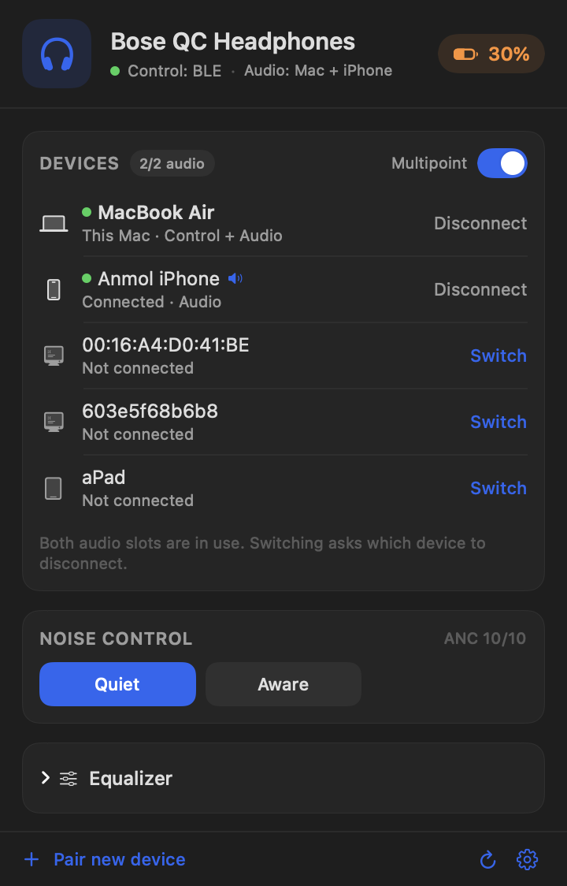
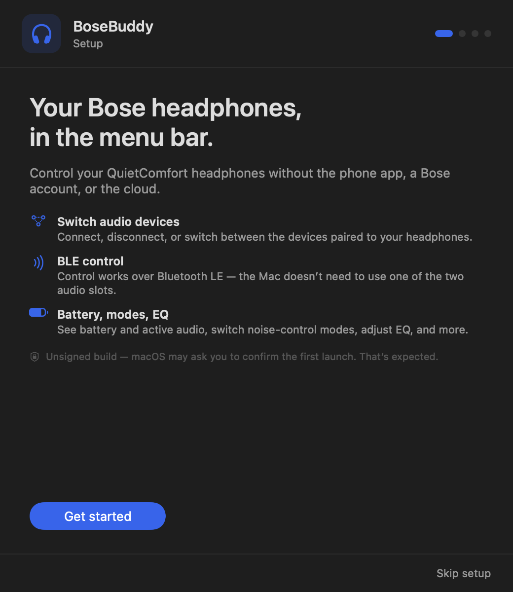
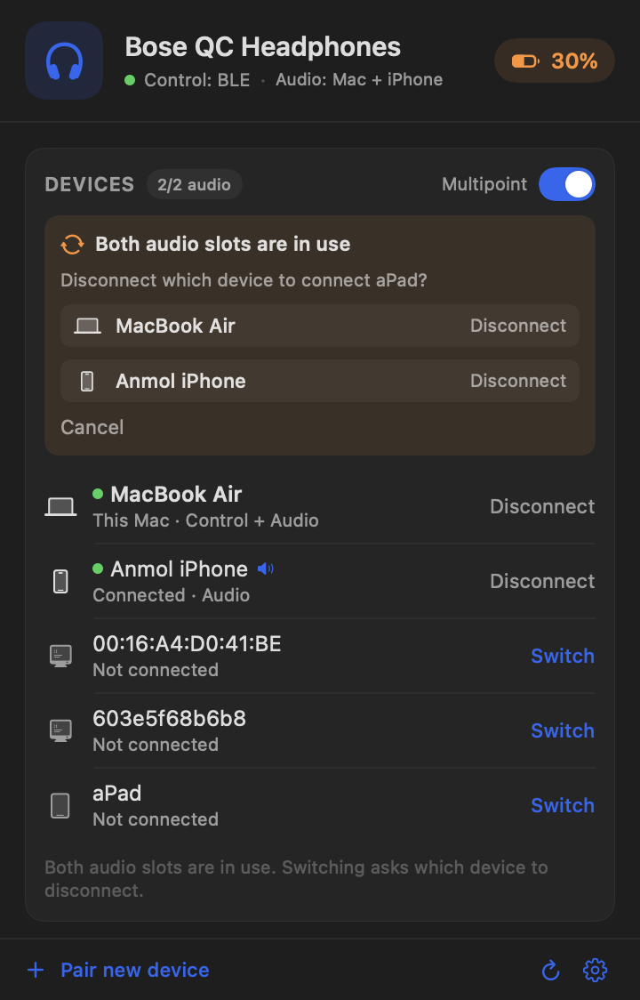

# BoseBuddy

**Control Bose QuietComfort headphones from the macOS menu bar — no phone app,
no Bose account, no cloud.**

BoseBuddy talks to the headphones directly over Bluetooth. It was built for the
QuietComfort Headphones (`prince`, product ID `0x4075`) and uses the same
reverse-engineered BMAP command set as the bigger tools.

<p align="center">
  
</p>

## Why

The Bose app is the only official place to manage the headphones' paired
devices. BoseBuddy gives you that on macOS, plus a few things the phone app does
not:

- **BLE control does not use one of the two audio slots.** Keep the headphones
  paired to your iPad and iPhone and still control them from the Mac.
- **Switch the Mac's audio in on demand** without dropping the other device.
- **Choose what to drop** when both audio slots are full.
- **No account, no cloud, no analytics.**

## Features

- Paired-device list with green connected indicators and an active-audio marker.
- **Connect / Disconnect / Switch** any device, including *This Mac*.
- **Switch chooser**: when 2 of 2 audio slots are in use, pick which device to
  disconnect. On by default. If turned off, the non-Mac device is dropped
  automatically.
- Mac audio on demand: **Connect audio** on the *This Mac* row.
- Battery and charging state.
- Noise-control modes (Quiet / Aware / custom).
- 3-band EQ and sidetone where supported.
- Multipoint on/off and pairing mode.
- Menu bar battery, launch at login, local diagnostics.
- Universal binary (Apple Silicon + Intel), macOS 14+.

## Install

### From a release (recommended)

1. Download **`BoseBuddy-1.0.0.dmg`** from the
   [Releases](../../releases) page.
2. Open the DMG and drag **BoseBuddy** to **Applications**. Eject the DMG.
3. **The first launch is blocked by Gatekeeper.** BoseBuddy is ad-hoc signed
   and not notarized, so macOS says it can't verify the app. This is expected.
   Open it once with one of these:

   - **Right-click → Open** in Applications, then **Open**.
   - Double-click it, click **Done** (not **Move to Trash**), then go to
     **System Settings → Privacy & Security → Open Anyway**.
   - Or clear the quarantine flag:

     ```sh
     xattr -dr com.apple.quarantine /Applications/BoseBuddy.app
     open /Applications/BoseBuddy.app
     ```

   Full walkthrough with every dialog: **[INSTALL.md](INSTALL.md)**.

   > **Do not click “Move to Trash.”** That deletes the app. Gatekeeper is
   > asking you to confirm an unsigned download, not reporting a virus.

4. macOS asks for **Bluetooth** access. Click **Allow**. This happens once per
   install — the app uses a stable code requirement so later launches and
   rebuilds reuse the grant.
5. Follow the setup guide: put the headphones in **pairing mode** (hold the
   Bluetooth button until the light blinks), keep them near the Mac, and click
   **Pair now**.
6. Click the **Bose logo** in the menu bar.

<p align="center">
  
</p>

### First-run checklist

- [ ] BoseBuddy is in **Applications** (not the DMG or Downloads).
- [ ] Gatekeeper has been cleared once — right-click **Open**, or
      **System Settings → Privacy & Security → Open Anyway**.
- [ ] macOS Bluetooth permission is granted (System Settings → Privacy &
      Security → Bluetooth).
- [ ] Headphones are in **pairing mode** for the one-time BLE bond.
- [ ] The Bose app on your phone is **closed** while pairing (one BLE central).

### Why is it unsigned?

Notarization requires a paid Apple Developer ID. BoseBuddy is a local,
open-source utility, so releases are ad-hoc signed. Gatekeeper asks once; the
source is available and the download can be checked against
`SHA256SUMS.txt`. The app has no networking, accounts, telemetry, or cloud.

## Pairing

BoseBuddy uses the Bose BLE service (`0000FEBE-…`) with the secure characteristic
(`C65B8F2F-…`). The first bond is created while the headphones are in pairing
mode; afterwards it persists.

If BoseBuddy says **Bluetooth LE pairing required**:

1. Put the headphones in pairing mode.
2. Open the menu bar panel.
3. Click **Retry BLE pairing** (or **Setup Guide…** in the gear menu).

The iPhone's Bose app can take the single BLE connection. If BoseBuddy cannot
find the headphones, close the Bose app and try again.

Classic RFCOMM is still supported as a fallback. It uses one of the two audio
slots; the gear menu has **Use Bluetooth LE for control** to switch modes.

## Using BoseBuddy

The header separates the two things that used to be confused:

```
Control: BLE  ·  Audio: Mac + iPhone
```

- **Control** is the app's link to the headphones (BLE or classic).
- **Audio** lists the devices currently connected for audio (up to two).
- A **green dot** in the device list means that device is connected for audio.
- A **speaker icon** marks the device currently playing.

### Devices

| Action | What it does |
|---|---|
| **Connect audio** on *This Mac* | Brings the Mac's audio online without dropping the other device. |
| **Disconnect** | Drops that device's audio. BLE control stays connected. |
| **Connect / Switch** on another device | Connects it. If both slots are full, the chooser asks what to drop. |
| **Multipoint** | Turns two-device mode on or off. |

<p align="center">
  
</p>

The **Switch chooser** is on by default. If you turn off
**Ask which device to disconnect** in the gear menu, the non-Mac device is
disconnected automatically, and the panel says so.

### Menu bar

The Bose logo shows the battery percentage. Click it to open the panel. The
gear menu has:

- Setup Guide…
- Use Bluetooth LE for control
- Reconnect control
- Ask which device to disconnect
- Show battery in menu bar
- Launch at login
- Open Bluetooth Settings
- Power off headphones
- Quit

## Troubleshooting

**BoseBuddy doesn't appear in the menu bar.**
The menu bar may be full. Quit other menu bar apps, or run BoseBuddy again from
Applications. The setup guide opens automatically on first launch.

**The Bluetooth prompt appears again after an update.**
macOS ties the permission to the app's code signature. Releases use a stable
designated requirement, so this should only happen once per install. If you
build from source with a different signature, macOS may ask again.

**“Bluetooth LE pairing required.”**
Put the headphones in pairing mode and click **Retry BLE pairing**.

**“Couldn't find the headphones.”**
Make sure they're on, nearby, and not exclusively held by the Bose app on your
phone. Close that app and retry.

**Mac audio doesn't show up.**
Click **Connect audio** on *This Mac*, then choose the headphones in
**System Settings → Sound**. If it still doesn't appear, press the Bluetooth
button on the headphones once.

**Everything connects but no audio.**
Check the macOS output device. The headphones can be connected for control
(`Control: BLE`) while `Audio: off`; that's normal.

**Diagnostics.**
BoseBuddy writes a capped log to `~/Library/Logs/BoseBuddy.log` with connection,
peer, and audio-profile transitions.

## Build from source

Requirements: macOS 14+, Xcode command line tools (Swift 5.9+).

```sh
git clone https://github.com/YOUR_NAME/BoseBuddy.git
cd BoseBuddy
make build      # dist/BoseBuddy.app (universal)
make package    # dist/release/*.zip, *.dmg, source zip, SHA256SUMS
make selftest   # headless BMAP check against paired headphones
```

`make install` copies the app to `/Applications` and launches it.

The build signs ad-hoc with a stable designated requirement:

```
designated => identifier "com.bosebuddy.app"
```

That keeps the Bluetooth TCC grant stable across rebuilds. The app is not
notarized.

### Repository layout

```
BoseBuddy/
  Sources/
    Bose/            BMAP codec, BLE + RFCOMM transports, controller
    UI/              menu bar panel, setup guide
    System/          CoreAudio monitor, logging
    AppDelegate.swift
    main.swift
  Resources/         Info.plist, icons
  docs/              screenshots
  build.sh           universal build
  package.sh         zip + dmg + source zip
  Makefile
```

## Protocol

BMAP packets are `[fblock, function, flags, length, payload…]`; the low nibble
of `flags` is the operator (`GET`, `SETGET`, `START`, `STATUS`, `ERROR`, …).

BoseBuddy prefers BMAP over BLE:

| Item | Value |
|---|---|
| BLE service | `0000FEBE-0000-1000-8000-00805F9B34FB` |
| Secure characteristic | `C65B8F2F-AEE2-4C89-B758-BC4892D6F2D8` |
| Unsecure characteristic | `D417C028-9818-4354-99D1-2AC09D074591` |
| Segmentation | 1-byte header, 19 data bytes per write |
| Classic fallback | RFCOMM channel 8 (2 and 9 probed) |

Device management commands:

| Action | Packet |
|---|---|
| List paired devices | `GET [4.4]` |
| Device info | `GET [4.5] <mac>` |
| Connect a device | `START [4.1] [0x00, mac…]` |
| Disconnect a device | `START [4.2] [mac…]` |
| Active source | `GET [5.1]` |
| Multipoint | `GET/SETGET [1.10]` |
| Modes | `START [31.1]` + `[31.6]` status |
| Switch mode | `START [31.3] [index, announce]` |
| Equalizer | `GET/SETGET [1.7]` |
| Battery | `GET [2.2]` |

The same `CONNECT` command is used for *This Mac* to bring up A2DP on demand.

## Privacy

BoseBuddy has no networking, accounts, telemetry, or cloud. Everything stays
between the Mac and the headphones. The only local file it writes is
`~/Library/Logs/BoseBuddy.log` (capped at 512 KB).

## Credits

Protocol work builds on:

- [aaronsb/bosectl](https://github.com/aaronsb/bosectl) — BMAP reverse
  engineering for QC Ultra and QuietComfort.
- [MadEyez/quietrebellion](https://github.com/MadEyez/quietrebellion) — Android
  and Windows ports.
- [NerdySouth/bozo](https://github.com/NerdySouth/bozo) — BMAP over BLE service
  and segmentation.
- [Gadgetbridge](https://gadgetbridge.org/gadgets/headphones/bose/) — Bose
  multipoint management reference.

BoseBuddy is unaffiliated with Bose. Bose and QuietComfort are trademarks of Bose
Corporation.

## License

MIT. See [LICENSE](LICENSE).
