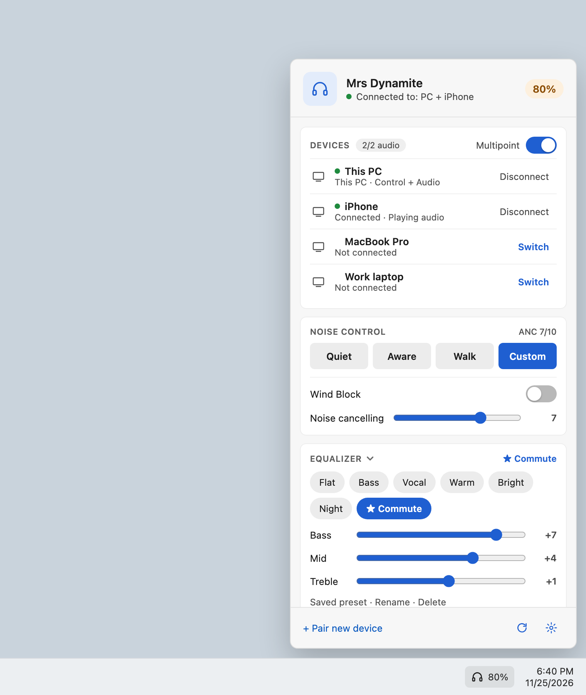

# QC Buddy — Windows port plan

Status: M0–M2 done; M3 and M4 built (Devices, mode editing, EQ, sidetone), hardware checks pending. Next: M5. Tray app in `windows/app`. Branch `feature/windows-port`.

## Goal

**QC Buddy** is the Windows sibling of BoseBuddy (macOS): a tray app with the
same features. It controls a Bose headset over the PC's existing Bluetooth
connection, with no phone app, account or cloud. Same look as the mockup
(<https://claude.ai/artifact/V6g4HQsg6A3ChrRgbrxFEy>; static copy and
screenshot in [`docs/`](docs/)): a flyout above the tray icon with Devices,
Noise control and Equalizer cards.



### Parity scope (v1)

| Feature | macOS source | Windows v1 |
|---|---|---|
| Battery in tray and header | `readBattery` | yes |
| Paired devices: connect / disconnect / switch, active-audio marker | `loadPeers`, `connectPeer`, `disconnectPeer` | yes |
| Auto-drop the non-PC device when both slots are full; "ask which" option | `connectPeer` | yes |
| Multipoint on/off, pairing mode | `setMultipoint`, `enterPairingMode` | yes |
| Noise modes incl. Walk, edit Wind Block / ANC, "+ Custom" | `NoiseModes.swift`, `updateMode`, `createCustomMode` | yes |
| Mode prompt on switch | `setMode` (announce = 1) | yes |
| EQ sliders, presets, custom presets (13-char names) | `EQPresets.swift`, `applyEQ` | yes |
| Sidetone | `setSidetone` | yes |
| "Connect audio" for this PC | `connectMacAudio` | spike first (see risks) |
| Detect renamed headsets by vendor ID 0x009E | `DeviceIdentity.swift` | yes |
| Logging (session, errors, failed requests, health) | `BarLog`, `RequestDescription.swift` | yes |
| Launch at login, onboarding | `SMAppService`, `OnboardingView` | yes (simpler onboarding) |
| Power off | `powerOff` | yes |

Out of scope for v1: switching between several Bose headsets (fork issue #4),
charging icon (QC45 doesn't report it, issue #3), firmware updates.

## Stack

- **Tauri 2**: Rust backend, web UI in WebView2, built-in tray icon.
- **UI**: TypeScript + React + Vite, styled from the mockup.
- **Protocol**: ported from BoseBuddy's own Swift sources (`Protocol.swift`,
  `NoiseModes.swift`, `BoseController.swift`), which already work on the
  QC45, into `windows/core`. Decided in M1 (2026-11-25) instead of
  [`bose-bmap`](https://crates.io/crates/bose-bmap): 0.6.0 doesn't compile
  for Windows (its RFCOMM transport uses Unix-only `std::os::fd` / `libc`
  sockets without a platform gate), and it lacks the 4.x peer commands. The
  QC45 mode layout still credits bosectl (MIT) in `modes.rs`.
- **Windows APIs**: Microsoft's `windows` crate: Winsock `AF_BTH` RFCOMM,
  Bluetooth device enumeration, Core Audio (`IMMDeviceEnumerator`,
  `IMMNotificationClient`).
- **Tauri plugins**: `single-instance` (M2), `autostart` (M5). EQ presets and
  logging are in the core (JSON file, our own logger), so no `store` / `log`.
  The flyout is placed by our own code, not `positioner`: bottom-right of the
  monitor's work area, which also works with the taskbar on another edge.

## Layout

`windows/core` (M1, done) is a library crate with no Tauri dependency, so CI
tests it without Node or WebView2. It also builds the **`qcbuddy` CLI**, which
runs every feature from a terminal for hardware testing without the UI (see
[`core/README.md`](core/README.md)). The Tauri app (M2) depends on it and
adds only the tray, window and IPC.

```
windows/
  PLAN.md
  core/                  qcbuddy-core + qcbuddy CLI (protocol, controller, worker,
                         peers, modes, eq_presets, identity, log, platform, fake)
  app/                   Tauri app (M2)
    src/                 React flyout: Header, NoiseCard (M2), DevicesCard (M3), EqualizerCard (M4)
    src-tauri/src/main.rs  tray, flyout placement, commands → core::worker::Command, `state` event
    icon-src/            SVG sources for the app and tray icons
```

Same repo, own folder: shares issues, README, website (bosebuddy.com) and the
captured test fixtures. The macOS app is unchanged.

## Architecture

- **One request at a time.** A single worker owns the RFCOMM socket and
  processes a queue (mpsc). This carries over the macOS fix where overlapping
  requests read each other's replies.
- **GetAll (31.1) is single-flight** and accepted only when its 31.1 RESULT
  arrives; retry up to 3x, keep the last good list.
- **Polling.** Battery/source/mode every 15 s only while the flyout is open;
  modes, EQ, sidetone and multipoint re-read on open. While it's closed, one
  light tick a minute: attach when Windows connects the headset (checks the
  PC's paired devices, no Bluetooth traffic), and read the battery every 5
  minutes for the tray icon (added in M2; the tray shows the battery as
  digits). Audio endpoint changes should come from Core Audio events (M5).
- **IPC**: Tauri commands for actions (`set_mode`, `update_mode`,
  `create_custom_mode`, `apply_eq`, `connect_peer`, ...); one `state` event the
  UI renders from.
- **Flyout**: frameless, always-on-top window sized to its content,
  anchored bottom-right of the work area, hidden on blur or Esc, toggled by
  tray left-click; right-click menu with Open / Quit.

## Milestones

| # | Milestone | Done when |
|---|---|---|
| M0 | **Spike** (4–6 days) | Console app on the Windows test PC passes the M0 checklist below and answers the risks. |
| M1 | Core ✅ | `controller`, `peers`, `modes`, `eq_presets`, `log` with unit tests ported from `Tests/*.swift` and the QC45 fixtures. Done: `windows/core`, 51 tests, `qcbuddy` CLI; all reads verified on the QC45. |
| M2 | Tray + flyout ✅ | Tauri app shows live battery and modes in the mockup UI. Done: flyout, mode switching, battery digits on the tray icon. |
| M3 | Devices | Paired list, connect / disconnect / switch, auto-drop, multipoint, pairing mode. Built (UI + core); switching devices still to be checked on hardware. |
| M4 | Noise + EQ | Mode editing, "+ Custom", EQ presets incl. custom names, sidetone. Built (UI + core; presets shared with the CLI in `eq-presets.json`); editing still to be checked on hardware. |
| M5 | Polish | Onboarding, autostart, settings, logging parity, light/dark. |
| M6 | Ship on GitHub Releases | NSIS `.exe` installer published on a GitHub release with SmartScreen instructions and a README section (see Distribution). |
| M7 | Microsoft Store (follow-up) | MSIX package accepted in the Store after v1 is stable (see Distribution). |

## M0 checklist

Run on the Windows test PC (see Test setup) with the QC45 paired and playing
audio. Each line is pass/fail and goes in the M0 report.

1. Opens RFCOMM channel 8 (fall back to 2, 9) while the QC45 is connected for
   audio; audio keeps playing throughout.
2. Reads battery, firmware, product name.
3. Reads the full mode list (Quiet, Aware, Walk, slot 3) via GetAll with the
   31.1 RESULT, and switches Quiet → Walk with the voice prompt.
4. **Core feature:** reads the headset's paired-device list (4.4) with
   connected / active state, the same data as BoseBuddy's `peers:` log line.
5. **Core feature:** disconnects the iPhone (4.2) and reconnects it (4.1);
   the device list reflects both.
6. With both audio slots full, connecting a third device follows BoseBuddy's
   auto-drop rule (drops the non-PC device).
7. "Connect audio" for this PC: from a state where the PC has only the control
   link, ask the headset to connect the PC (CONNECT self) and check whether
   Windows brings up the audio endpoint.
8. Requests are serialized: a GetAll during other reads never returns a
   mixed-up reply (run it in a loop for a minute).

### M0 results (2026-11-25, Dell test PC, QC45 fw 4.0.4)

| # | Result |
|---|---|
| 1 | **Pass.** Channel 8 opens on the first try while the headset plays audio; audio kept playing. The audio was from the MacBook (see the Remote Desktop note), so playback from the PC itself is still to be confirmed. |
| 2 | **Pass.** Battery, firmware, name. The 1.2 name reply starts with a 0x00 byte; BoseBuddy's parser stops at it and shows the default name (macOS bug, fixed in `core`). |
| 3 | Pass via the `qcbuddy` CLI: the full mode list (Quiet, Aware, Walk, Custom) with the 31.1 RESULT. Mode switching not yet run on hardware. |
| 4 | **Pass.** The paired-device list with connected / local flags and the active source. |
| 5–7 | Not run on hardware; covered by the controller tests against the simulated headset. Run with `qcbuddy connect / disconnect / pc-audio`. |
| 8 | **Pass.** 34 rounds of mixed requests in 20 s, no mismatched or incomplete replies. |

Findings:

- **Remote Desktop hides the PC's audio.** In an RDP session the only active
  output is "Remote Audio": sound goes PC → RDP → client → headset, so the
  headset reports the client as the source. Hardware audio checks need the
  RDP client set to "Play on remote computer", or the PC's own screen.
- Windows exposes the Device ID profile in PnP instance IDs
  (`VID&0001009E`), so renamed headsets are found by vendor ID.
- The GNU Rust toolchain (`x86_64-pc-windows-gnu`) builds everything too;
  MSVC stays the target for releases.

## Risks to settle in M0

1. **RFCOMM while audio is connected.** Can an app open channel 8 on Windows
   while the headset is connected for A2DP/HFP, and does the audio keep
   playing?
2. **Winsock `AF_BTH` vs WinRT `RfcommDeviceService`.** WinRT finds services by
   UUID through SDP; we connect by channel number like macOS. Try Winsock first.
3. **"Connect audio" for this PC.** On macOS the app asks the headset to
   connect the Mac (CONNECT self) and macOS brings up audio. Windows may need
   to start the audio connection itself.
4. **Multipoint behaviour** with the Windows Bluetooth stack (auto-drop,
   active-source marker).
5. **WebView2 memory** (expect 50–100 MB) and whether that's acceptable for a
   tray app.
6. **SmartScreen** on an unsigned installer (same problem as Gatekeeper on
   macOS).

## Test setup

- **Hardware:** an Intel (x64) Windows PC with built-in Bluetooth, the QC45
  paired to it, plus the iPhone (and the Mac) as the headset's other devices
  for multipoint tests. x64 is the primary target; Windows on ARM is later.
- **Workflow:**
  1. Write code on the Mac in the `BoseBuddy-windows` worktree; push
     `feature/windows-port`.
  2. CI (GitHub Actions, `windows-latest`) builds and runs the Rust unit tests
     on every push. Runners have no Bluetooth, so CI never talks to a headset.
  3. On the Windows PC: pull, build (`cargo run` for the spike, `npm run tauri
     dev` for the app), and run the hardware checks. Logs from
     `%LOCALAPPDATA%\QC Buddy\QCBuddy.log` come back to the Mac for review.
- **Windows PC setup:** Rust (MSVC toolchain + Visual Studio Build Tools with
  the "Desktop development with C++" workload), Node LTS, Git; WebView2 is
  already on current Windows 10/11. Tauri CLI comes in with the app's npm
  dependencies.

## Testing

- Unit tests in Rust against packets captured from the QC45 (the same records
  `Tests/NoiseModeTests.swift` uses).
- UI tests (Vitest) render real core states: `core/src/ui_fixtures.rs`
  writes them as JSON, and the test fails if they're stale, which keeps the
  Rust state and `types.ts` in step.
- A hardware checklist per release:
  [`HARDWARE-CHECKLIST.md`](HARDWARE-CHECKLIST.md).
- Only one headset (QC45, fw 4.0.4) is available; other models are best-effort
  and labelled as such.

## Open questions

- Contribute the Windows transport and the 4.x peer commands back to bosectl?

## Distribution

### v1: GitHub Releases (M6)

- **Installer:** Tauri's **NSIS `.exe`** (`QCBuddy_<version>_x64-setup.exe`),
  per-user install (no admin), bundles the WebView2 bootstrapper for PCs
  without it. No MSI for now.
- **Where:** a GitHub release on this repo, alongside the macOS assets, with
  SHA-256 checksums.
- **Signing:** ship **unsigned** at first, like the macOS DMG. The release
  notes and README explain SmartScreen's "Windows protected your PC" screen
  (More info → Run anyway). Revisit with Azure Trusted Signing if the warning
  hurts adoption.
- **Updates:** Tauri updater plugin, reading a `latest.json` attached to the
  GitHub release. It needs its own update-signing key (separate from code
  signing); keep the private key out of the repo, in a GitHub Actions secret.
- **Launch at login:** Tauri `autostart` plugin (registry Run key), fine
  outside MSIX.
- **Third-party notices:** credit bosectl (MIT) for the QC45 mode layout in
  the About screen; list the Rust crates' licenses with the installer.

### Follow-up: Microsoft Store (M7)

- **Package:** **MSIX**, which the Store signs, so Store users get no
  SmartScreen warning and get automatic updates through the Store.
- **Tauri doesn't build MSIX**; package the release build with Microsoft's MSIX
  tooling (`makeappx` / MSIX Packaging Tool) in CI.
- **MSIX changes the app:**
  - Launch at login becomes a declared `StartupTask` instead of the registry
    Run key (the Run key is virtualized inside MSIX).
  - File writes under AppData are redirected, so read the log path from the
    API at runtime rather than hard-coding it.
  - Turn off the Tauri updater in the Store build; the Store updates the app.
- **Listing:** "QC Buddy — works with Bose QuietComfort headphones", no Bose
  logos or artwork; needs a Microsoft developer account, privacy statement
  (no telemetry, logs stay local) and screenshots.
- Check Microsoft's current Store, signing and account requirements before
  starting M7; they change.

Not planned: winget (can be added later as a manifest pointing at the GitHub
release), standalone MSIX outside the Store.

## Name

**QC Buddy** (decided 2026-11-25).

- Product name "QC Buddy", executable `QCBuddy.exe`, bundle identifier
  `com.qcbuddy.app`, install folder and log folder `QC Buddy`.
- Avoids "Bose" in the name, which keeps the Microsoft Store open as an
  option. Descriptions still say it works with Bose QuietComfort headphones
  (factual compatibility), with no Bose logos or artwork.
- The macOS app stays BoseBuddy. The README and bosebuddy.com link to QC Buddy
  as the Windows version.
